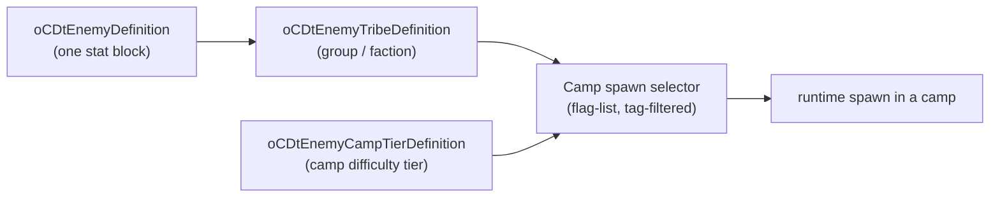

import { Aside, Badge, Steps, LinkCard, CardGrid } from '@astrojs/starlight/components';

Custom enemies are a **clone-and-patch** kind: you start from a vanilla enemy,
change its stats/assets, and register it as a new definition. <Badge text="Confirmed" variant="success" />

<Aside type="tip" title="Proven in game (2026-09-24)">
A clone spawns in real camps: a Gnolls-tribe clone wearing a Mud Crab body
appeared in Storm Island gnoll camps. The def joins its tribe's roster when it
loads, and camps pick from that roster. Keep the clone's **tribe** set to one
the target biome's camps use. Keep its **body** (`entity`) to a creature that
biome streams. Leave **`power`** near vanilla: it is the enemy's cost against
the camp's power budget, not its spawn odds, and a clone priced above the budget
is never picked.
</Aside>

## Author one

The enemy kind is confirmed, so no `experimental` opt-in is needed.

```python title="build.py"
from rsmm import sdk

with sdk.Mod("MyEnemies") as mod:
    mod.enemy(
        "Frost_Goblin",
        base="Goblins/Goblin_Warrior",   # vanilla donor to clone
        name="Frost Goblin",
        # **fields override stat-block values on the clone
    )
```

Equivalent declarative form:

```toml title="mods/MyEnemies/manifest.toml"
[mod]
id = "MyEnemies"

[[content]]
kind = "enemy"
id   = "Frost_Goblin"
base = "Goblins/Goblin_Warrior"
name = "Frost Goblin"
```

`Mod.boss(...)` takes the same shape. Bosses are **not** a separate class — they
are ordinary enemies tagged into the boss flag-list and gated by the boss-timer
controller.

Run `./rsmm apply` to cook and register the definition.

## Custom AI <Badge text="Experimental" variant="caution" />

A clone shares its base's AI until you give it an `ai` table. Then it gets an
entity of its own: a copy of the base's variant with your numbers and attack
order applied. The copy is also added to every biome pool that streams the
base, and the base itself is not touched. How the AI works is described in
[Enemy AI (RE)](https://github.com/Ovilli/RavenswatchModManager/blob/main/docs/_re/kinds/enemy-ai.md).

```toml title="mods/RabidWolves/manifest.toml"
[mod]
id = "RabidWolves"
experimental = true          # `ai` is not proven in game yet

[[content]]
kind = "enemy"
id   = "Rabid_Wolf"
base = "Standard_Wolf_Timber"

[content.ai]
detect_radius = 12           # notices heroes from 12 units (vanilla 6)
aggro_delay   = 0.1          # reacts in 0.1 s (vanilla 0.5)
leash         = 80           # chases twice as far before going home (vanilla 40)
attacks = ["Attack Giant Leap", "Attack Bite"]   # priority order
```

| Key | Part it sets | Vanilla |
|---|---|---|
| `detect_radius` | Wandering Target Detection Radius Default | 6 |
| `alerted_detect_radius` | Wandering Target Detection Radius Alerted | 16 |
| `alert_radius` | Wandering Alert Detection Radius (allies in combat this close alert it) | 9 |
| `aggro_delay` / `alerted_aggro_delay` | Wandering Target Delay Default / Alerted | 0.5 / 0.25 s |
| `roam_distance` | Wandering Roam Distance | 5 |
| `chase_radius` | Fighting Target Detection Radius | 30 |
| `leash` | Fighting Max Leash Distance | 40 |
| `attack_min` / `attack_best` / `attack_max` | Fighting Seek Min / Best / Max Attack Distance | 1 / 2 / 3.5 |
| `give_up_delay` | Fighting Exit Delay | 3 s |
| `values` | any other number by part name, e.g. `{ "Attack Bite Cooldown Value" = 1 }` | |
| `attacks` | the family's attacks this enemy uses, highest priority first | the base's |

The vanilla column is the NPC_Common default; a family or variant may already
override it (Timber's attack distances are its own). `attacks` can name any
attack group of the enemy's family (`rsmm entity-graph
'Enemies\Wolves\Wolves_Model.entity.ot'` lists them as `Attack …` groups), so a
Timber wolf can learn the Alpha's Giant Leap. The other entries (leash, U-turn,
seek, target lost) keep their places around them. Scripted enemies with no
fighting selector of their own (scarecrows, eggs) refuse `attacks`.

### New attacks: `ai.new_attacks` <Badge text="Experimental" variant="caution" />

Beyond its family's own attacks, an enemy can get new ones. Each one is a copy
of a family attack (its state, condition, cooldown, hit and timing), renamed,
with animations and numbers of its own. Add it to `attacks` like any other.

```toml
[[content.ai.new_attacks]]
name = "Attack Belly Slam"               # must start with "Attack "
from = "Attack Giant Leap"               # the family attack it copies
animations = { "Attack Giant Leap Anim" = "Characters\\Heroes\\Kintaro\\Animations\\Kintaro_Bear_FishSlam_Ultimate1_In.fbx" }
values     = { "Attack Giant Leap Radius Value" = 6 }
```

`animations` and `values` name the **source's** parts, as
`rsmm entity-graph '<family model>' --group "<from>"` lists them. Inside the copy,
`from` becomes `name` in every part name (`State Attack Belly Slam`). The
copies live in the clone's own family model, so the base family is untouched.
Hit timing follows the animation. An attack's hits, effects and sounds are timed in
seconds on its animation component, and the attack ends with the clip. So every
swapped animation (here or in `reskin`) has those times scaled by the new
clip's length over the old one's. Without that, a shorter animation never reaches
its hit.

### New body and animations: `reskin` <Badge text="Experimental" variant="caution" />

`reskin` maps a path the enemy's family uses to one it should use instead:
its mesh, material, and every animation. The clone then gets a copy of its
family model (`<id>_Model.entity.ot`) with the swaps applied, so the base is
not changed. Everything swapped in is preloaded through the clone's resource
cache, borrowed from the shipped caches that already list it, so any shipped
art works, even a hero's.

```toml
[content.reskin]
"Characters\\Enemies\\Wolves\\Wolf_Alpha_GEO.fbx"                  = "Characters\\Heroes\\Kintaro\\Kintaro_Bear_GEO.fbx"
"Characters\\Enemies\\Wolves\\Animations\\Wolf_Alpha_GiantLeap.fbx" = "Characters\\Heroes\\Kintaro\\Animations\\Bear_Kintaro_Leap.fbx"
```

An attack's hit timing is data on its animation component, not in the FBX.
A swapped animation's times are scaled to its length (see above), so pair moves
of the same role: the hit lands at the same point of the move, not the same
second. A swap whose source the enemy does not use is an
error that lists the art it does use. `mods/kuma-bear` (Kintaro's bear as an
elite wolf-camp enemy) is a full example.

## How enemies spawn

Spawning is **selector-driven**, not a direct "place enemy X" call. The chain:



An enemy reaches a run by being a member of a **tribe**, which a **camp
selector** picks via tags/flags at the right difficulty tier. So registering a
definition is necessary but not sufficient — something must select it.

<Aside type="note" title="Known scaffold bug">
The early scaffold patched the *tribe definition* directly (`tribe_patch`) to
inject the new enemy. That's the wrong layer — selection happens through the
flag-list selector, not the tribe table. The open task is confirming the
selector resolves the new enemy from the runtime library, then driving the
membership from there.
</Aside>

### Class map

The full camp/enemy machinery, for when you need the internals:

| Class | UID | Library | Purpose |
|---|---|---|---|
| `oCDtEnemyDefinition` | `0x176debb7` | `0x1414118c0` | one enemy stat block |
| `oCDtEnemyTribeDefinition` | — | `0x141411200` | tribe = group / faction |
| `oCDtEnemyCampTierDefinition` | `0x176e18f8` | `0x141411560` | difficulty tier of one camp |
| `oCDtEnemyCampDifficultyDefinition` | — | `0x141411710` | global difficulty curve |
| `oCDtEnemyCampEntitySelectorToSpawnEntityCpntSettings` | `0x16b7d175` | — | per-camp spawn selector |
| `oCDtEnemyCampEntitySelectorToSpawnTribeEntrySettings` | `0x16b81d80` | — | one tribe entry inside a camp |
| `oCDtEnemyFlagListEntitySelectorToSpawnEntityCpntSettings` | `0x17019bf9` | — | tag-filtered enemy selector |

`oCDtEnemyDefinition` is fully registered (size `0x350`, factory `FUN_14030a190`).
The runtime spawn primitive itself — the `vftable[3]` call that constructs an
entity at a position — is documented in [Spawning](/reverse-engineering/spawning/).

## Going deeper

<CardGrid>
  <LinkCard title="Spawning (RE)" href="/reverse-engineering/spawning/" description="The engine's runtime entity-creation primitive." />
  <LinkCard title="Mod hooks (RE)" href="/reverse-engineering/mod-hooks/" description="Enemies, bosses, and the level-load pipeline." />
  <LinkCard title="SDK: Mod.enemy" href="/reference/sdk-api/builder/" description="Generated API reference for the enemy builder." />
  <LinkCard title="Authoring mods" href="/guides/modding/" description="The full content-kind authoring guide." />
</CardGrid>
