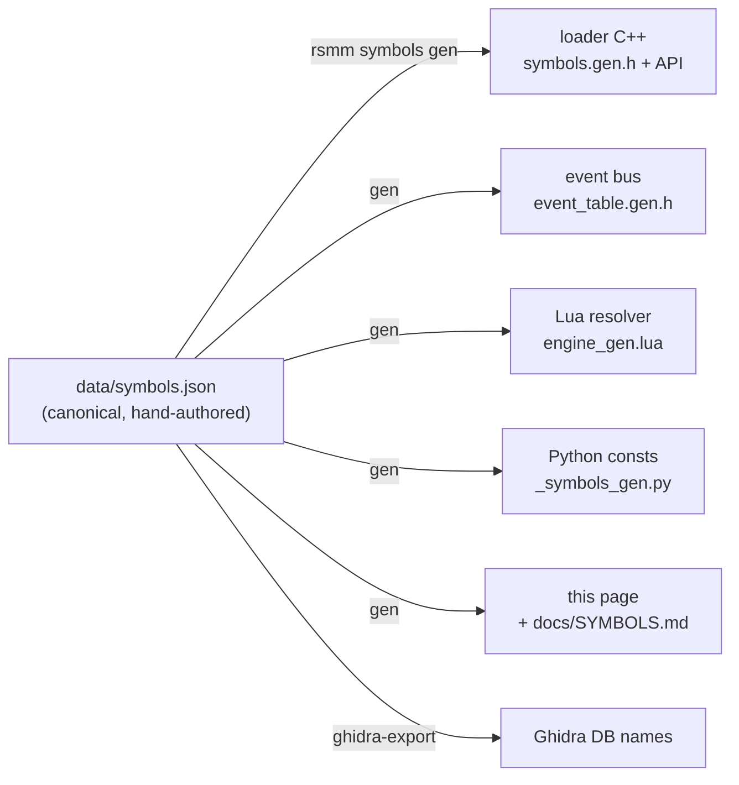

One human-authored source (`data/symbols.json`) generates every downstream artifact:

> GENERATED by `rsmm symbols gen` from `data/symbols.json` — do not edit by hand.

Canonical map of Ravenswatch engine functions/globals/events to stable
semantic names. `status`: **ok** = resolvable by byte pattern in the current
corpus (survives game updates); **va** = base-relative absolute (data globals);
**unverified** = documented in an older corpus, address not re-confirmed.
Functions tagged `callable` have a typed C++ accessor in `engine::` and a Lua
resolver entry. See [CLAUDE.md] for the workflow.

Total: **409** symbols across 29 categories.

## analytics

| name | address | status | callable | signature / note |
|------|---------|--------|----------|------------------|
| `AnalyticsBag_SetInt` | `0x140204830` | ✅ ok |  | void*(void* bag, void* keyDesc, uint64_t value, void* alloc) |
| `AnalyticsBag_SetString` | `0x1401fb7e0` | ✅ ok |  | void*(void* bag, void* keyDesc, void* valueDesc, void* alloc) |
| `Analytics_EmitActiveBoss` | `0x1401f2d40` | ✅ ok |  | void(void* analyticsCtx, void* args, void* unused) |
| `Analytics_EmitChapterEnd` | `0x1401ef840` | ✅ ok |  | void(void* analyticsCtx, void* args, void* unused) |
| `Analytics_EmitHeroDeath` | `0x1401f0a20` | ✅ ok |  | void(void* analyticsCtx, void* args, void* unused) |
| `Analytics_EmitObjectProposed` | `0x1401f1330` | ✅ ok |  | void(void* analyticsCtx, void* args, void* unused) |
| `Analytics_EmitObjectSelected` | `0x1401f1590` | ✅ ok |  | void(void* analyticsCtx, void* args, void* unused) |
| `Analytics_EmitOpenChest` | `0x1401f2b00` | ✅ ok |  | void(void* analyticsCtx, void* args, void* unused) |
| `Analytics_EmitSandmanBuy` | `0x1401f03d0` | ✅ ok |  | void(void* analyticsCtx, void* args, void* unused) |
| `Analytics_EmitSkillProposed` | `0x1401f0cf0` | ✅ ok |  | void(void* analyticsCtx, void* args, void* unused) |
| `Analytics_EmitSkillSelected` | `0x1401f1010` | ✅ ok |  | void(void* analyticsCtx, float* skillEvent, void* unused) |
| `Analytics_EmitUnlockSkill` | `0x1401f1a20` | ✅ ok |  | void(void* analyticsCtx, void* args, void* unused) |

## camera

| name | address | status | callable | signature / note |
|------|---------|--------|----------|------------------|
| `CameraModifier_AddChild` | `0x1406606e0` | ✅ ok | ✔ | void(void* modifier, void* parent, bool instant) |
| `CameraModifier_Evaluate` | `0x1406604e0` | ✅ ok |  | void(void* modifier, const float* dt, void* camState, float parentWeight) |
| `CameraModifier_RemoveChild` | `0x140660800` | ✅ ok | ✔ | void(void* parent, void* modifier) |
| `TopDownCamera_Activate` | `0x1407e6a70` | ✅ ok |  | void(void* topDownCameraCpnt) |
| `g_CameraModifier_vftable` | `0x140f67b20` | 📍 va |  | [2026-11-19: relocated 0x140f62ea0 -> 0x140f67b20 for the 2026-11-17 patch (2a88a3bd564… |
| `g_CameraSceneContext_vftable` | `0x140f0f6a0` | 📍 va |  | [2026-11-19: relocated 0x140f0a910 -> 0x140f0f6a0 for the 2026-11-17 patch (2a88a3bd564… |
| `g_ZoomCameraModifier_vftable` | `0x140f678d0` | 📍 va |  | [2026-11-19: relocated 0x140f62b38 -> 0x140f678d0 for the 2026-11-17 patch (2a88a3bd564… |

## combat

| name | address | status | callable | signature / note |
|------|---------|--------|----------|------------------|
| `CharacterController_ClearStagger` | `0x1403c38a0` | ✅ ok | ✔ | void(void* charController) |
| `HeroStats_OnDamageDealt` | `0x1403a3900` | ✅ ok |  | void(oCDtEntityCpntHeroController* hero, oCEntity* victim, oCDtProcessedDamage* payload… |
| `HeroStats_OnDamageTaken` | `0x1403a9330` | ✅ ok |  | void(void* hero, void* payload) |
| `ProjectileAttack_BeginAttack` | `0x14083d1e0` | ✅ ok | ✔ | void(void* projectile_attack_cpnt) |

## enemies

| name | address | status | callable | signature / note |
|------|---------|--------|----------|------------------|
| `EnemyCamp_Stage3Filter` | `0x1403154a0` | ❓ unverified |  | void(void* candidatesVec, void* searchFilter) |
| `EnemyCamp_TierSelector` | `0x140337490` | ✅ ok |  | void(void* selector) |
| `EnemyCamp_TribeEntryBuilder` | `0x140338b20` | ✅ ok |  | void(void* selector, void* specialEntry, void* outEntries, float mult) |
| `EnemyDef_PostLoad` | `0x140315ee0` | ✅ ok |  | bool(void* enemyDef) |
| `EnemyDefinition_ctor` | `0x1401d8d80` | ✅ ok |  | void*(void* self) |
| `EnemyTribeDef_PostLoad` | `0x1403171c0` | ✅ ok |  | bool(void* tribeDef) |
| `EnemyTribeDefinition_ctor` | `0x1400bdd20` | ✅ ok |  | void*(void* self) |
| `Enemy_RuntimeSpawnPicker` | `0x14033a3b0` | ❓ unverified |  | void(void* spawnerCpnt) |
| `MapCtx_DistributeEnemyCampTiers` | `0x1401e23e0` | ✅ ok |  | void(void* mapSceneContext) |

## engine

| name | address | status | callable | signature / note |
|------|---------|--------|----------|------------------|
| `Entry_Ctor` | `0x14020f760` | ✅ ok | ✔ | void(void* base, uint32_t count) |
| `Format_String` | `0x140202f00` | ✅ ok |  | printf-style format/string builder (e.g. 'Is Hero liked by {}', 'Chance to give {} MO')… |
| `LevelLoad_Orchestrator` | `0x140289030` | ✅ ok |  | i64(void* levelGs) |
| `String_Assign` | `0x14052bf10` | ✅ ok | ✔ | void(void* dst_slot, const StringDesc* src) |
| `Vector_Grow` | `0x14014db60` | ✅ ok | ✔ | void(void* vec, void* /*dead RDX*/, uint32_t new_cap /*R8*/) |

## engine-core

| name | address | status | callable | signature / note |
|------|---------|--------|----------|------------------|
| `AppSettings_SectionList` | `0x1412f5d60` | 📍 va |  | Global list of application-settings SECTIONS: {void** data @+0x0, u32 count @+0x8}. Rea… |
| `ClassRegistry_FindByKey` | `0x14050b8b0` | ✅ ok |  | void*(void* unused, void* identityKey) |
| `ClassRegistry_Global` | `0x141436b90` | 📍 va |  | Global class-descriptor registry: ptr to {descPtr array @+0x0, u32 count @+0x8}. Scanne… |
| `Component_GetTypeId` | `0x1401e0500` | ✅ ok |  | uint32_t(void* component) |
| `Controller_GetFieldByKey` | `0x14039f7b0` | ✅ ok |  | void*(void* controller, uint32_t key) |
| `CustomFlagFilter_Serialize` | `0x140182160` | ❓ unverified |  | bool(void* flagFilter, void* reader) |
| `CustomFlagList_Serialize` | `0x1406690a0` | ❓ unverified |  | bool(void* flagList, void* reader) |
| `Engine_MainThreadId` | `0x141444408` | 📍 va |  | Thread id of the engine main thread. LevelLoad_ProgressTick compares GetCurrentThreadId… |
| `Engine_Singleton` | `0x14143ddc0` | 📍 va |  | Pointer to the oe::Engine singleton (object at 0x14143daf0; ctor FUN_1404564d0 stores b… |
| `GameScene_FindContextByTester` | `0x14066b8c0` | ✅ ok |  | void*(void* gameScene, void* kindOfTypeTester) |
| `MetaClass_AddMember` | `0x14050a060` | ✅ ok |  | void(void* metaClass, void* member, uint32_t id, void* name, void* unused, void* userData) |
| `MetaClass_Construct_Zero16` | `0x1401a2010` | ❓ unverified |  | void(void* obj) |
| `MetaClass_Construct_Zero8` | `0x1401a1ea0` | ❓ unverified |  | void(void* obj) |
| `MetaClass_DestructInPlace` | `0x1401a1e60` | ❓ unverified | ✔ | void(void* obj) |
| `MetaClass_DestructInPlace_Slot0` | `0x1401a3860` | ❓ unverified |  | void(void* obj) |
| `MetaClass_FindMember` | `0x14050c350` | ✅ ok |  | void* (void* metaClass, uint32_t nameOrId, void* kind, bool searchParents) |
| `MetaClass_GetObjectClass` | `0x1401b2180` | ❓ unverified |  | void*(void* obj) |
| `Profiler_GetThreadScopeStack` | `0x1405226e0` | ❓ unverified |  | void*(void) |
| `Property_EvaluateByGuid` | `0x1406aa6d0` | ✅ ok |  | bool(void* ctx, void* container, void* guid16, float* out) |
| `ResourceRef_Serialize` | `0x1401c1970` | ✅ ok |  | bool(void* reader, void* refSlot) |
| `Serializer_GetClassVersion` | `0x1404fd350` | ✅ ok |  | void*(void* reader, void* out, uint32_t classHash) |
| `Serializer_ReadEnum` | `0x140206090` | ✅ ok |  | bool(void* serializer, void* vec) |
| `Serializer_ReadObjectNamed` | `0x140500ea0` | ✅ ok |  | bool(void* loader, void* root, const char* name) |
| `Serializer_ReadObjectPayload` | `0x140500850` | ✅ ok |  | bool(void* loader, void* obj, const char* name) |
| `Serializer_ReadPolyPtrVector` | `0x140207c40` | ✅ ok |  | bool(void* reader, void* vec, const char* label) |
| `Serializer_ReadVectorObjIds` | `0x1402ed4c0` | ✅ ok |  | bool(void* serializer, void* vec) |
| `Serializer_ReadVectorU32` | `0x14035db40` | ✅ ok |  | bool(void* serializer, void* vec) |
| `Serializer_ReadVectorU8` | `0x14035df90` | ✅ ok |  | bool(void* serializer, void* vec) |
| `Serializer_ResolveObjectId` | `0x1405007b0` | ✅ ok |  | bool(void* loader, void** out, const char* label) |
| `ServiceRegistry_Global` | `0x14146f740` | 📍 va |  | Global engine service registry: service array @+0x30, u32 count @+0x38; each entry -> s… |
| `StringVector_Serialize` | `0x14066c190` | ❓ unverified |  | bool(void* reader, void* strVec) |
| `Vector_InsertRange` | `0x14014e010` | ✅ ok | ✔ | void*(void* vector, unsigned index, unsigned count) |

## entity

| name | address | status | callable | signature / note |
|------|---------|--------|----------|------------------|
| `EnemyController_Ctor` | `0x140392340` | ✅ ok | ✔ | oCDtEntityCpntEnemyController*(oCDtEntityCpntEnemyController* self) |
| `EnemyController_vftable` | `0x140f36f30` | 📍 va |  | Vftable of oCDtEntityCpntEnemyController. Derived from MSVC RTTI (type descriptor .?AVo… |
| `EntityPool_AllocNode` | `0x14068fbb0` | ✅ ok |  | void*(void* pool) |
| `EntitySpawner_InstantiateRecord` | `0x14072fd80` | ✅ ok |  | void(oCEntityCpntEntitySpawner* self, void* spawnRecord) |
| `EntitySpawner_SpawnOne` | `0x14072ef50` | ✅ ok |  | void(oCEntityCpntEntitySpawner* self) |
| `EntityStore_CreateEntity` | `0x1406f4b70` | ✅ ok | ✔ | oCEntity*(oCEntitySpawner* spawner, oCEntitySettings* settings, oCEntitySpawnData* spaw… |
| `EntityValueEntry_Ctor` | `0x1407469c0` | ✅ ok | ✔ | void(void*, void*) |
| `EntityValueOverride_Alloc` | `0x14076e5e0` | ✅ ok | ✔ | void*(void*, uint32_t, uint32_t) |
| `EntityValueStore_ApplyModifierEvent` | `0x14074ab90` | ✅ ok | ✔ | void(void* store, void* modifierEvent, void* a3, void* a4) |
| `EntityValueStore_InitBaseValues` | `0x1407477c0` | ✅ ok | ✔ | void(void* store) |
| `EntityValueStore_Recompute` | `0x140749330` | ✅ ok | ✔ | void(void* store, void* valueDef) |
| `EntityValueUnion_Compare` | `0x14082b4c0` | ✅ ok | ✔ | uint32_t(void*, void*) |
| `EntityValueUnion_CopyAssign` | `0x1408297e0` | ✅ ok | ✔ | void(void*, void*) |
| `EntityValueUnion_DefaultCtor` | `0x140829070` | ✅ ok | ✔ | void*(void*) |
| `EntityValueUnion_Destruct` | `0x14082c0f0` | ✅ ok | ✔ | void(void*) |
| `EntityValueUnion_InitAsType` | `0x14082bc80` | ✅ ok | ✔ | void(void*, uint32_t) |
| `EntityValue_Get` | `0x1403bf600` | ✅ ok | ✔ | void(void* valueCtx, oCEntityValueUnion* out, uint32_t crcKey) |
| `EntityValue_Lookup` | `0x140748b00` | ✅ ok | ✔ | oCEntityValueUnion*(void* store, oCEntityValueUnion* out, uint32_t crcKey) |
| `Entity_AllocInstance` | `0x14068fbb0` | ❓ unverified | ✔ | void*(void* allocator) |
| `Entity_DispatchHit` | `0x1406e2aa0` | ✅ ok | ✔ | void(oCEntity* target, oCEntityHitData* hit) |
| `Entity_FindComponentByType` | `0x1406e1fd0` | ✅ ok | ✔ | oIEntityCpnt*(oCEntitySpawnerGo* go, oCMetaClass* meta) |
| `Entity_FindMagicalObjectComponent` | `0x1406fb8a2` | ❓ unverified | ✔ | void*(void* instance, void* mo_component_meta) |
| `Entity_GainHealthHandler` | `0x1403a2710` | ✅ ok |  | void(oCEntity* hero, void* a2, void* valueCtx) |
| `Entity_GetComponentByTester` | `0x1406e1fd0` | ✅ ok | ✔ | void*(void*, void*) |
| `Entity_GetComponentFast` | `0x1406e1f60` | ✅ ok | ✔ | void*(void*, void*, uint32_t) |
| `Entity_ResolveAttackHits` | `0x1403d5c60` | ✅ ok | ✔ | float(void* attacker, uint hitDefIndex, TargetList* targets, float damageMul, float bas… |
| `HeroController_Ctor` | `0x140397540` | ✅ ok | ✔ | oCDtEntityCpntHeroController*(oCDtEntityCpntHeroController* self) |
| `HeroController_HudMirror_Ctor` | `0x140400920` | ✅ ok |  | Builds the hero's HUD HP-mirror object whose pointer is stored at hero+0x1d80 by HeroCo… |
| `Hero_ModifyDreamShards` | `0x1403a2d30` | ✅ ok | ✔ | void(oCDtEntityCpntHeroController* hero, float delta, oCCustomFlagList* sourceTags) |
| `HitPoint_SetHitPoints` | `0x140821190` | ✅ ok | ✔ | void(oCEntityCpntHitPoint* hp, float value) |
| `MapCtx_LinkPairedSpawners` | `0x1401e5680` | ✅ ok |  | void(void* mapSceneContext) |
| `ModifierEvent_Ctor` | `0x140392650` | ✅ ok | ✔ | void*(void* buf, void* valueDef) |
| `g_MagicalObjectComponentMeta` | `0x141469098` | 📍 va |  | oCMetaClass* for the magical-object component; passed to Entity_FindMagicalObjectCompon… |
| `oCCustomFlagList_vftable` | `0x140f02dc0` | 📍 va |  | vftable of oCCustomFlagList. An empty list is the 0x18-byte struct { vftable @+0x0, lis… |
| `oCEntityHitData_vftable` | `0x140f14f48` | 📍 va |  | vftable of oCEntityHitData (the ~0xb0-byte hit descriptor passed to Entity_DispatchHit … |
| `oCEntityValueUnion_vftable` | `0x140f96c40` | 📍 va |  | vftable of oCEntityValueUnion, the ~0x20-byte tagged value returned by EntityValue_Look… |
| `oCGameEventNetworkModifier_vftable` | `0x140f39180` | 📍 va |  | vftable of oCGameEventNetworkModifier — the durable stat-modifier named event (leaf of … |

## entity-values

| name | address | status | callable | signature / note |
|------|---------|--------|----------|------------------|
| `EntityValueRegistry_RegisterAll` | `0x1401d3e80` | ✅ ok |  | void(void) |
| `SceneContextValue_Find` | `0x1401c2110` | ✅ ok | ✔ | oCEntityValueUnion*(void* sceneContext, uint32_t crcKey) |
| `SceneContextValue_SetBool` | `0x140202c70` | ✅ ok | ✔ | void(void* sceneContext, uint32_t crcKey, bool value) |
| `SceneContextValue_SetFloat` | `0x1402041c0` | ✅ ok | ✔ | void(void* sceneContext, uint32_t crcKey, float value) |
| `SceneContextValue_SetInt` | `0x140202e00` | ✅ ok | ✔ | void(void* sceneContext, uint32_t crcKey, int32_t value) |
| `g_GlobalEntityValueSceneContext_Tester_vftable` | `0x140f0b5d8` | 📍 va |  | Vftable of oCTKindOfTypeTester<oCGlobalEntityValueSceneContext, oIGameSceneContext>, re… |

## event

| name | address | status | callable | signature / note |
|------|---------|--------|----------|------------------|
| `Analytics_SubmitNamedEvent` | `0x1401f4940` | ✅ ok | ✔ | void(void* analytics_mgr, void* payload_kv, StringDesc* event_name, char has_run_ctx) |
| `Crc32_TableInit` | `0x14051e6f0` | ✅ ok |  | Builds the 256-entry CRC32 lookup table at DAT_141436710 (lazy, runtime — the table is … |
| `EventQueue_Drain` | `0x1406630b0` | ✅ ok |  | void(void* queue) |
| `Event_LevelUp` → `level_up` | `0x1401f07c0` | ✅ ok | ✔ | Emitter whose body references the 'level_up_reach' string (xref 0x1401f64a4). void(ctx,… |
| `Event_RunEnd` → `run_end` | `0x1401ef590` | ✅ ok | ✔ | Emitter whose body references the 'run_end' string (xref 0x1401f5347). Loader post-deto… |
| `Hero_GainRerollHandler` | `0x1403b38b0` | ✅ ok |  | void(void* hero, void* ev) |
| `Id_HashString` | `0x1405287a0` | ❓ unverified |  | Runtime string -> 32-bit id hasher: standard CRC32 over the name bytes (init 0xffffffff… |
| `NamedEvent_ChannelMap_Find` | `0x14066ca00` | ✅ ok | ✔ | iter*(void* channel_map, iter* out, uint32_t* event_id) |
| `NamedEvent_Delete` | `0x14011fef0` | ✅ ok | ✔ | void(oCGameNamedEvent* ev) |
| `NamedEvent_Dispatch` | `0x14066a490` | ✅ ok | ✔ | void(void* dispatcher, oCGameNamedEvent* ev) |
| `NamedEvent_EmitNetworkDamageFromHit` | `0x140726330` | ✅ ok |  | Reference emitter for NETWORK_DAMAGE: stack-builds the full oCGameNamedEventNetworkDama… |
| `NamedEvent_GainDreamShards_Ctor` | `0x1402e1910` | ✅ ok |  | void*(void* buf) |
| `NamedEvent_GainReroll_Ctor` | `0x1402e1ae0` | ✅ ok | ✔ | oe::dt::NamedEventGainReroll*(void* buf) |
| `NamedEvent_GiveMagicalObject_Ctor` | `0x14030aa60` | ✅ ok | ✔ | oe::dt::NamedEventGiveMagicalObject*(void* buf) |
| `NamedEvent_HeroSubscribeAll` | `0x14039a220` | ✅ ok | ✔ | void(oCEntity* hero) |
| `NamedEvent_HeroUnsubscribeAll` | `0x14039dd10` | ✅ ok |  | Hero teardown twin of NamedEvent_HeroSubscribeAll: walks the same (id global, slot) pai… |
| `NamedEvent_Id_FromCrc` | `0x14051e850` | ✅ ok | ✔ | uint32_t(uint32_t ns, uint32_t name_crc) |
| `NamedEvent_NetSend` | `0x1407202b0` | ✅ ok | ✔ | void(void* net_event_cpnt, oCGameNamedEvent* ev) |
| `NamedEvent_NetSendToPeer` | `0x140720340` | ✅ ok | ✔ | void(void* net_event_cpnt, oCGameNamedEvent* ev, uint64_t* peer_session) |
| `Reroll_GrantToHeroes` | `0x1402e5c60` | ✅ ok |  | The game's own reroll grant: builds a GainReroll event on the stack with the count (an … |
| `oCDtNamedEventGainDreamShards_vftable` | `0x140f23cf8` | 📍 va |  | vftable of oCDtNamedEventGainDreamShards, the GAIN_DREAM_SHARDS event a pickup sends. 0… |
| `oCDtNamedEventGainReroll_vftable` | `0x140f278c8` | 📍 va |  | vftable of oCDtNamedEventGainReroll, the GAIN_REROLL named event (bus id = NamedEvent_I… |
| `oCGameEventGainIngredient_vftable` | `0x140f27958` | 📍 va |  | vftable of oCGameEventGainIngredient, the GAIN_INGREDIENT event. 0x58 bytes; ctor 0x140… |
| `oCNamedEventNetworkWithData_vftable` | `0x140f10910` | 📍 va |  | vftable of oCNamedEventNetworkWithData (RTTI name, docs/_re/out_new/vftables.jsonl), th… |

## gameplay

| name | address | status | callable | signature / note |
|------|---------|--------|----------|------------------|
| `DayNightCycle_InitCycle` | `0x1401e6630` | ✅ ok |  | Per-CHAPTER setup of the day/night component (this = component in RCX), called from the… |
| `DayNightCycle_PushValues` | `0x1401e7bc0` | ✅ ok |  | Per-frame writer for the 'Day/Night cycle' value family (see DayNightCycle_RegisterValu… |
| `DayNightCycle_RegisterValues` | `0x1401e85a0` | ✅ ok |  | Registers the 'Day/Night cycle' entity-value family: 27 named values plus 9 named trigg… |

## hero

| name | address | status | callable | signature / note |
|------|---------|--------|----------|------------------|
| `GroupLevelComponent_Ctor` | `0x1402dca10` | ✅ ok | ✔ | void*(void* self) |
| `Hero_GainExperience` | `0x1402ddb30` | ✅ ok | ✔ | void(void*, void*) |
| `XpComponent_GetMaxLevel` | `0x1402dd960` | ✅ ok | ✔ | uint32_t(void*) |
| `XpComponent_IsMaxLevel` | `0x1402dd9c0` | ✅ ok | ✔ | bool(void*) |
| `XpComponent_SetLevel` | `0x1402dddc0` | ✅ ok | ✔ | void(void*, uint32_t) |
| `XpComponent_SetXp` | `0x1402de260` | ✅ ok | ✔ | void(void*, uint32_t) |
| `XpComponent_TypeTester` | `0x141478140` | 📍 va |  | Type-tester global (DAT_141476e00) used by the XP component's own IsKindOf/parent-resol… |
| `XpComponent_XpForLevel` | `0x1402dd860` | ✅ ok | ✔ | uint32_t(void*, uint32_t) |
| `XpComponent_vftable` | `0x140f24878` | 📍 va |  | Vftable of the hero's XP/level component. CORRECTED 2026-07-18 from 0x140f23200, which … |

## heroes

| name | address | status | callable | signature / note |
|------|---------|--------|----------|------------------|
| `ChallengeUnlock_IsUnlocked` | `0x1402abd70` | ✅ ok | ✔ | bool(void* condition_data) |
| `HeroDef_Deserialize` | `0x14031a770` | ✅ ok | ✔ | bool(oCDtHeroDefinition* def, oCBinaryStream* stream) |
| `HeroDef_LoadBaseEntity` | `0x14031a520` | ✅ ok |  | void(void* heroDef, void** outEntityRef) |
| `HeroDef_LoadSkinEntity` | `0x14031a280` | ✅ ok |  | void(void* heroDef, uint16_t skinIndex, void* outHandle) |
| `HeroDefinition_Ctor` | `0x1403196f0` | ✅ ok |  | void*(void* self) |
| `HeroProgressionUnlock_IsUnlocked` | `0x1402ad810` | ✅ ok | ✔ | bool(void* condition_data) |
| `HeroRankLock_IsUnlocked` | `0x1402ac8f0` | ✅ ok | ✔ | bool(void* condition_data) |
| `HeroStoryUnlock_IsUnlocked` | `0x1402acea0` | ✅ ok | ✔ | bool(void* condition_data) |

## input

| name | address | status | callable | signature / note |
|------|---------|--------|----------|------------------|
| `InputActionMap_Add` | `0x140471260` | ✅ ok | ✔ | ActionEntry*(void* map, const oCString* name, const u32 keyboard[4], const u32 pad[4]) |
| `Input_Poll` | `0x14067e400` | ✅ ok |  | void(void* inputManager, const void* frameTime) |
| `g_CursorLockCentre` | `0x141474d00` | 📍 va |  | [2026-11-19: relocated 0x14146d9c0 -> 0x141474d00 for the 2026-11-17 patch (2a88a3bd564… |
| `g_CursorLockFlag` | `0x14146eea7` | 📍 va |  | [2026-11-19: relocated 0x141467b67 -> 0x14146eea7 for the 2026-11-17 patch (2a88a3bd564… |
| `g_InputActionMap` | `0x14143dea8` | 📍 va |  | [2026-11-19: relocated 0x141436b68 -> 0x14143dea8 for the 2026-11-17 patch (2a88a3bd564… |
| `g_InputKeyRecords` | `0x14146df90` | 📍 va |  | [2026-11-19: relocated 0x141466c50 -> 0x14146df90 for the 2026-11-17 patch (2a88a3bd564… |
| `g_InputManager` | `0x141476c28` | 📍 va |  | [2026-11-19: relocated 0x14146f8e8 -> 0x141476c28 for the 2026-11-17 patch (2a88a3bd564… |
| `g_InputMouseWheelDown` | `0x14146e3ec` | 📍 va |  | [2026-11-19: relocated 0x1414670ac -> 0x14146e3ec for the 2026-11-17 patch (2a88a3bd564… |
| `g_InputMouseWheelUp` | `0x14146e3e0` | 📍 va |  | [2026-11-19: relocated 0x1414670a0 -> 0x14146e3e0 for the 2026-11-17 patch (2a88a3bd564… |
| `g_MouseState` | `0x141474d08` | 📍 va |  | [2026-11-19: relocated 0x14146d9c8 -> 0x141474d08 for the 2026-11-17 patch (2a88a3bd564… |

## items

| name | address | status | callable | signature / note |
|------|---------|--------|----------|------------------|
| `Entity_GiveHandler` | `0x1403bebc0` | ✅ ok |  | void(oCEntityValueContext* heroValueCtx, oCEntity* hero, void* hitCtx) |
| `Entity_LookupMagicalObjectComponent` | `0x1406e2040` | ✅ ok | ✔ | void*(void* componentStore, void** out, oCEntity* entity) |
| `Hero_GrantMagicalObject` | `0x1403a04b0` | ✅ ok | ✔ | void(oCDtEntityCpntHeroController* hero, void* def, uint16_t count, char dupFlag, void*… |
| `InitialLoading_SpawnMagicalObjects` | `0x14025b1d0` | ✅ ok |  | Boot 'InitialLoading - MagicalObject SpawnAllObjects' caller that invokes SpawnAllObjec… |
| `MagicalObjectPool_Grow` | `0x140156dc0` | ❓ unverified | ✔ | void(void* pool_plus_0x10, uint32_t count, uint32_t by) |
| `MagicalObjectPool_SourceLookup` | `0x140253f10` | ❓ unverified | ✔ | void*(void* pool, void* out, void* id) |
| `MagicalObject_RegisterInstance` | `0x1403b4a60` | ✅ ok | ✔ | void(oCDtEntityCpntHeroController* hero, void* instance, char addToActive) |
| `MagicalObject_SpawnAllObjects` | `0x1402535b0` | ✅ ok | ✔ | void(void* pool, void* scene) |
| `g_MagicalObjectPool` | `0x14143de08` | 📍 va |  | [2026-07-10: re-derived post 2026-07-09 patch (was 0x1414365d0); confirmed via readers … |

## library

| name | address | status | callable | signature / note |
|------|---------|--------|----------|------------------|
| `AchievementDef_PostLoad` | `0x14030cd90` | ✅ ok | ✔ | bool(void* definition) |
| `ChallengeDef_PostLoad` | `0x140320850` | ✅ ok | ✔ | bool(void* definition) |
| `Crt_Free` | `0x140ce4460` | ✅ ok |  | void(void* p) |
| `DefinitionRegistry_Ctrl` | `0x1412f1a68` | 📍 va |  | Instance registry SwissTable (absl flat_hash_map) keyed on the class-descriptor pointer… |
| `DefinitionRegistry_Mask` | `0x1412f1a80` | 📍 va |  | Instance registry SwissTable (absl flat_hash_map) keyed on the class-descriptor pointer… |
| `DefinitionRegistry_Slots` | `0x1412f1a70` | 📍 va |  | Instance registry SwissTable (absl flat_hash_map) keyed on the class-descriptor pointer… |
| `Definition_DeserializeBase` | `0x14030aeb0` | ✅ ok |  | bool(void* def, void* reader) |
| `Definition_PostLoad` | `0x14030af30` | ✅ ok | ✔ | bool(void* definition) |
| `Definition_PreUnload` | `0x14030af60` | ✅ ok | ✔ | void(void*) |
| `Definition_Unload` | `0x14031f1c0` | ✅ ok |  | bool(void* definition) |
| `DreamShardDef_PostLoad` | `0x140314cc0` | ✅ ok | ✔ | bool(void* definition) |
| `EnemyCampTierDef_PostLoad` | `0x140315020` | ✅ ok | ✔ | bool(void* definition) |
| `GameModeDefaultDef_PostLoad` | `0x140321270` | ✅ ok | ✔ | bool(void* definition) |
| `GameModifierDef_PostLoad` | `0x140321b70` | ✅ ok | ✔ | bool(void* definition) |
| `GameModifierDef_RegisterAssetLoader` | `0x1403219d0` | ✅ ok |  | void(void* assetClassDesc) |
| `GoPtrOwnerRelay_ForwardCall` | `0x14066acf0` | ✅ ok |  | oIGoPtrOwnerRelay base virtual (slot +0x18): resolves owned via slot-0x30, forwards own… |
| `GoPtrOwnerRelay_ForwardGet` | `0x14066ac60` | ✅ ok |  | oIGoPtrOwnerRelay base virtual (vtable 0x140f06820 slot +0x8): resolves the owned objec… |
| `GoPtrOwnerRelay_ForwardSet` | `0x14066acb0` | ✅ ok |  | oIGoPtrOwnerRelay base virtual (slot +0x10): resolves owned via slot-0x30, forwards own… |
| `HasGameModifierStateMachine_Register` | `0x1401900b0` | ✅ ok |  | void(void) |
| `HeroDef_PostLoad` | `0x14031b5f0` | ✅ ok | ✔ | bool(void* definition) |
| `IngredientDef_PostLoad` | `0x14031eab0` | ✅ ok | ✔ | bool(void* definition) |
| `Library_AchievementDefinition_vftable` | `0x140f28d98` | 📍 va |  | vftable of oCTLibrary<oe::dt::AchievementDefinition> singleton. ⚠ ADDRESS CORRECTED 202… |
| `Library_ChallengeDefinition_vftable` | `0x140f2b568` | 📍 va |  | vftable of oCTLibrary<oe::dt::ChallengeDefinition> singleton. ⚠ ADDRESS CORRECTED 2026-… |
| `Library_DreamShardDefinition_vftable` | `0x140f2b408` | 📍 va |  | vftable of oCTLibrary<oCDtDreamShardDefinition> singleton. ⚠ ADDRESS CORRECTED 2026-09-… |
| `Library_EnemyCampDifficultyDefinition_vftable` | `0x140f2c5d0` | 📍 va |  | vftable of oCTLibrary<oCDtEnemyCampDifficultyDefinition> singleton. ⚠ ADDRESS CORRECTED… |
| `Library_EnemyCampTierDefinition_vftable` | `0x140f2c610` | 📍 va |  | vftable of oCTLibrary<oCDtEnemyCampTierDefinition> singleton. ⚠ ADDRESS CORRECTED 2026-… |
| `Library_EnemyDefinition_vftable` | `0x140f2cb10` | 📍 va |  | vftable of oCTLibrary<oCDtEnemyDefinition> singleton. ⚠ ADDRESS CORRECTED 2026-09-17: t… |
| `Library_EnemyTribeDefinition_vftable` | `0x140f2c7c8` | 📍 va |  | vftable of oCTLibrary<oCDtEnemyTribeDefinition> singleton. ⚠ ADDRESS CORRECTED 2026-09-… |
| `Library_EntitySettingsResource_vftable` | `0x140f77ba8` | 📍 va |  | vftable of oCTLibrary<oCEntitySettingsResource> singleton. ⚠ ADDRESS CORRECTED 2026-09-… |
| `Library_GameModifierDefinition_vftable` | `0x140f2b940` | 📍 va |  | vftable of oCTLibrary<oe::dt::GameModifierDefinition> singleton. GameModifiers = the ru… |
| `Library_IngredientDefinition_vftable` | `0x140f2b5a8` | 📍 va |  | vftable of oCTLibrary<oCDtIngredientDefinition> singleton. ⚠ ADDRESS CORRECTED 2026-09-… |
| `Library_MapDefinition_vftable` | `0x140f2b3b0` | 📍 va |  | vftable of oCTLibrary<oCDtMapDefinition> singleton. ⚠ ADDRESS CORRECTED 2026-09-17: the… |
| `Library_MelodyDefinition_vftable` | `0x140f2b688` | 📍 va |  | vftable of oCTLibrary<MelodyDefinition> singleton. ⚠ ADDRESS CORRECTED 2026-09-17: the … |
| `Library_RewardDefinition_vftable` | `0x140f2b448` | 📍 va |  | vftable of oCTLibrary<oCDtRewardDefinition> singleton. ⚠ ADDRESS CORRECTED 2026-09-17: … |
| `Library_TileDefinition_vftable` | `0x140f2c8e8` | 📍 va |  | vftable of oCTLibrary<oCDtTileDefinition> singleton. ⚠ ADDRESS CORRECTED 2026-09-17: th… |
| `Library_VersionDefinition_vftable` | `0x140f2b370` | 📍 va |  | vftable of oCTLibrary<oe::dt::VersionDefinition> singleton (LiveOps version manifest). … |
| `MapDef_PostLoad` | `0x14031ee10` | ✅ ok | ✔ | bool(void* definition) |
| `MapDef_RegisterAssetLoader` | `0x14031ec70` | ✅ ok |  | void(void* assetClassDesc) |
| `MelodyDef_PostLoad` | `0x140322870` | ✅ ok | ✔ | bool(void* definition) |
| `Mem_Alloc16Zeroed` | `0x14050cbf0` | ✅ ok |  | malloc(0x10) + zero two qwords + bump global alloc counter DAT_1414442b4 = 16-byte zero… |
| `PtrVector_Resize` | `0x14014db60` | ✅ ok |  | pointer-vector resize: param_3==0 frees vec[0] (free-counter DAT_14146d854), else mallo… |
| `Registry_EnemyDefinition_desc` | `0x141470208` | 📍 va |  | Class registry descriptor for oCDtEnemyDefinition (set by registrar FUN_14022d940; UID … |
| `Registry_EnemyTribeDefinition_desc` | `0x141476c78` | 📍 va |  | [2026-11-19: relocated 0x14146f938 -> 0x141476c78 for the 2026-11-17 patch (2a88a3bd564… |
| `RewardDef_RegisterAssetLoader` | `0x14031fd80` | ✅ ok |  | void(void* assetClassDesc) |
| `Rt_FailFast` | `0x140ccb8d4` | ✅ ok |  | CRT fail-fast: FUN_140cc7c90 then _invoke_watson (noreturn). 4459 refs. Naming it de-no… |
| `SharedRef_AddRefCopy` | `0x14015ecd0` | ✅ ok |  | base virtual: copies {*(this+0x18) data, *(this+0x20) refblock} into out and addrefs at… |
| `SharedRef_AddRefCopy_b` | `0x140218650` | ✅ ok |  | identical twin of SharedRef_AddRefCopy (separate TU); base virtual in 298 vtables. Deco… |
| `SharedRef_Release` | `0x14010a830` | ✅ ok | ✔ | void(void*) |
| `Std_AllocateBytes` | `0x140120bd0` | ✅ ok |  | void*(size_t n) |
| `TileDef_Deserialize` | `0x14031ffb0` | ✅ ok |  | bool(oCDtTileDefinition* def, oCBinaryStream* stream) |
| `TypeDesc_HashName` | `0x1404fd980` | ✅ ok |  | base virtual: vcall slot0 -> type descriptor, reads its oCString name (inline @+8 / hea… |
| `TypeDesc_HashName_b` | `0x1401c21f0` | ✅ ok |  | identical twin of TypeDesc_HashName (separate TU); base virtual in 292 vtables. Decompi… |
| `oCString_Dtor` | `0x14010a8d0` | ✅ ok |  | oCString destructor: SSO threshold 0xf; heap buffer's real alloc ptr at [buf-8], frees … |

## melodies

| name | address | status | callable | signature / note |
|------|---------|--------|----------|------------------|
| `HeroMelodyPersistentData_vftable` | `0x140f146d0` | 📍 va |  | vftable of HeroMelodyPersistentData ("Dt Hero Controller Owned Melody Persistent Data",… |
| `MelodyDefinition_Ctor` | `0x140322440` | ✅ ok |  | void*(void* self) |
| `NamedEvent_ChooseMelody_Ctor` | `0x1402d4e20` | ✅ ok | ✔ | oe::dt::NamedEventChooseMelody*(void* buf) |
| `oCGameNamedEventChooseMelody_vftable` | `0x140f27140` | 📍 va |  | vftable of NamedEventChooseMelody (RTTI .?AVNamedEventChooseMelody@dt@oe@@, typedesc 0x… |
| `oCGameNamedEventRemoveMelody_vftable` | `0x140f23e40` | 📍 va |  | vftable of NamedEventRemoveMelody (typedesc 0x14137bc38); same shape and origin as oCGa… |

## netcode

| name | address | status | callable | signature / note |
|------|---------|--------|----------|------------------|
| `Entity_GetNetComponent` | `0x14030d8b0` | ✅ ok | ✔ | void*(oCEntity* entity) |
| `Entity_GetNetId` | `0x140726050` | ✅ ok |  | uint32_t(void* entity) |
| `Fcm2_OnClosedConnection` | `0x140ac90e0` | ✅ ok |  | void(FullyConnectedMesh2* this, const SystemAddress& addr, RakNetGUID guid, int reason) |
| `Netcode_Channel_LookupById` | `0x14023bd10` | ✅ ok | ✔ | iter*(void* channel_map, iter* out, uint32_t* event_id) |
| `Netcode_Channel_Unsubscribe` | `0x1401c18b0` | ✅ ok | ✔ | void(void* node_plus_8, void** sub_slot) |
| `Netcode_ConnectionFactory` | `0x140b27010` | ✅ ok |  | Builds a Stormancer::RakNetConnection for an incoming RakNetGUID and files it in the co… |
| `Netcode_ConnectionRegistry_Emplace` | `0x140b2e5e0` | ✅ ok |  | MSVC std::unordered_map<uint64,...>::try_emplace for the netcode's CONNECTION REGISTRY.… |
| `Netcode_DropPeer` | `0x1402ae5e0` | ✅ ok |  | Drops a peer after the reconnect window (default 60s) elapses. Pattern-verified 2026-07… |
| `Netcode_EntityReplSetup` | `0x140720980` | ✅ ok | ✔ | void(oCEntityCpntNetwork* self) |
| `Netcode_PeerStateTick` | `0x1402ab010` | ✅ ok |  | Per-peer connection-state tick (peer conn-state enum at peer+0xCC; 3=connected). Reconn… |
| `Netcode_ReconnectMaxRead` | `0x1402ab3b7` | ✅ ok |  | (code location, not callable) |
| `Netcode_SessionCtx_LocalGuid` | `0x1408b6700` | ✅ ok |  | oCDtP2PSessionSceneContext::vft[0x88] — returns THIS machine's session id. Ghidra 2026-… |
| `P2PSession_OnFcm2NewHost` | `0x1408b76e0` | ✅ ok |  | The game's ID_FCM2_NEW_HOST handler -- i.e. where RakNet's FullyConnectedMesh2 host ELE… |
| `P2PSession_SetState` | `0x14085b4b0` | ✅ ok |  | void(oCDtP2PSessionSceneContext* ctx, int newState) |
| `P2PSession_StateNames` | `0x140eee910` | 📍 va |  | struct { const char* s; uint32 len; } [14]  // 0x10 stride |
| `RakNetConnection_Ctor` | `0x140b997b0` | ✅ ok |  | Stormancer::RakNetConnection constructor. Ghidra 2026-08-21: installs Stormancer::IConn… |
| `RakPeer_Ctor` | `0x140add300` | ✅ ok |  | RakNet::RakPeer* (RakNet::RakPeer* this) |
| `RakPeer_DefaultTimeoutStore` | `0x140ade1b0` | ✅ ok |  | (code location, not callable) |
| `RakPeer_GetGuidFromSystemAddress` | `0x140ae3010` | ✅ ok |  | RakNetGUID(RakPeer* this, const SystemAddress& addr) |
| `RakPeer_GetMyGUID` | `0x140ae2ec0` | ✅ ok |  | const RakNetGUID&(RakPeer* this) |
| `RakPeer_GetSystemAddressFromGuid` | `0x140ae31b0` | ✅ ok |  | SystemAddress(RakPeer* this, const RakNetGUID& guid) |
| `RakPeer_GetSystemList` | `0x140ae1340` | ✅ ok |  | void(RakPeer* this, List<SystemAddress>& addresses, List<RakNetGUID>& guids) |
| `SLNetworkObject_GetOwnerId` | `0x1408bfef0` | ✅ ok |  | void* __fastcall(oCSLNetworkObject* self, uint64_t* out) |

## network

| name | address | status | callable | signature / note |
|------|---------|--------|----------|------------------|
| `Lobby_SetRequestedHero` | `0x140267be0` | ✅ ok | ✔ | Sets the local lobby member's RequestedHero (+0x10) and RequestedSkin (u16 +0x14) and p… |

## options

| name | address | status | callable | signature / note |
|------|---------|--------|----------|------------------|
| `CustomizeChallengePage_CollectSelectedDefs` | `0x140427ca0` | ✅ ok | ✔ | void(void* pageCtrl, void* indexVec, void* outDefsVec) |
| `CustomizeChallengePage_OnToggleModifier` | `0x140428000` | ✅ ok | ✔ | void(void* pageCtrl, void* modifierUiCtrl) |
| `GameModifierUi_PadSelectedSlots` | `0x14035b760` | ✅ ok | ✔ | void(void* uiController, void* unknown, void* selectedVector) |
| `GameOptionsManager_Register` | `0x14066ab20` | ✅ ok | ✔ | void(GameOptionsManager* mgr, u8 category, GameOption* option) |
| `GameOptionsManager_RequestLoad` | `0x140691110` | ✅ ok | ✔ | void(void* unused, FileRequest* req /* = mgr+8 */) |
| `InputKeyGameOption_vftable` | `0x140f021b0` | 📍 va |  | [2026-11-19: relocated 0x140efd440 -> 0x140f021b0 for the 2026-11-17 patch (2a88a3bd564… |
| `g_GameOptions` | `0x14143dd50` | 📍 va |  | [2026-07-10: re-derived post 2026-07-09 patch (was 0x141436510); ctor is now FUN_1401ca… |
| `g_GameOptionsManager` | `0x14143dd70` | 📍 va |  | [2026-11-19: relocated 0x141436a38 -> 0x14143dd70 for the 2026-11-17 patch (2a88a3bd564… |

## progression

| name | address | status | callable | signature / note |
|------|---------|--------|----------|------------------|
| `GameModifierLock_OnStateChange` | `0x140257fc0` | ✅ ok | ✔ | The 'Playing with Modifiers will not unlock Difficulties, Achievements or Outfits' rule… |
| `RunRoster_Apply` | `0x14026aab0` | ✅ ok | ✔ | Stores a roster into the run state: FUN_1401dd670(game+0x6d8, roster) (so game+0x728 = … |
| `RunRoster_ApplyModifiers` | `0x14026ac90` | ✅ ok | ✔ | void(void* rootGs, void* roster) |
| `RunRoster_Build` | `0x140269260` | ✅ ok | ✔ | Builds the run's hero ROSTER into param_2 (an OUT container; ctor 0x1400c3250 / dtor 0x… |

## registry

| name | address | status | callable | signature / note |
|------|---------|--------|----------|------------------|
| `DefRegistry_Begin` | `0x141441380` | 📍 va |  | [2026-11-19: relocated 0x14143a040 -> 0x141441380 for the 2026-11-17 patch (2a88a3bd564… |
| `DefRegistry_End` | `0x141441388` | 📍 va |  | [2026-11-19: relocated 0x14143a048 -> 0x141441388 for the 2026-11-17 patch (2a88a3bd564… |

## resource

| name | address | status | callable | signature / note |
|------|---------|--------|----------|------------------|
| `BinarySaver_CollectDependencies` | `0x1404fcf10` | ✅ ok |  | bool(void* saver, void* rootObject) |
| `BinarySaver_WriteGraph` | `0x140501b60` | ✅ ok | ✔ | bool(void* saver, void* rootObject, const char* label, void* ctx) |
| `BinarySaver_WriteObject` | `0x140501800` | ✅ ok | ✔ | bool(void* saver, void* object, const char* label, bool flag) |
| `Definition_LoadPreloadSet` | `0x1404aade0` | ✅ ok | ✔ | void(void* preloadSet, int* outCount) |
| `Definition_PreloadResourceCache` | `0x14030bce0` | ✅ ok |  | void(void* definition) |
| `Definitions_LoadGroup` | `0x14030b030` | ✅ ok |  | Loads the 'Definitions' group / VersionDefinition manifest (triggers loading the curate… |
| `EntitySettings_ClassDescDefault` | `0x1414770d0` | 📍 va |  | [2026-11-19: relocated 0x14146fd90 -> 0x1414770d0 for the 2026-11-17 patch (2a88a3bd564… |
| `FileStream_Open` | `0x14053a1f0` | ✅ ok |  | bool(void** outHandle, const char* path, int* mode) |
| `InitialLoading_LoadAllDefinitions` | `0x14025b1d0` | ✅ ok |  | void(void* nameFilter) |
| `LevelBinary_Load` | `0x140476a90` | ✅ ok |  | bool(void* container, void* stream, void* lvlId, void* links) |
| `LevelDatabase_BuildAndRegister` | `0x14047d510` | ✅ ok |  | bool(void* db, void* level, bool flag) |
| `LevelLoad_AbortPredicate` | `0x140457220` | ✅ ok |  | uint32_t() |
| `LevelLoad_ProgressTick` | `0x140516410` | ✅ ok |  | uint32_t(float delta) |
| `LevelObject_DestroyVectors` | `0x1404774f0` | ❓ unverified |  | void(void* container) |
| `LevelObject_LoadOrCreate` | `0x14047c770` | ✅ ok |  | bool(void* mgr, void* key, void** outLevel, char link, char flag, void* lvlId, void* re… |
| `LevelStream_LoadLevel` | `0x14047ba80` | ✅ ok |  | bool(void* mgr, void* key, void** outLevel, char applyLinks, void* userData) |
| `LevelStream_LoadStep` | `0x140476d00` | ✅ ok |  | bool(void* container, void* resourceSlot, void* lvlId, void* links) |
| `LevelStream_ProgressHook` | `0x1412ecf30` | 📍 va |  | Function pointer for load-progress phases, set to LevelLoad_AbortPredicate in FUN_14045… |
| `LevelText_Load` | `0x1404768f0` | ✅ ok |  | bool(void* container, char** name, void* lvlId, void* links) |
| `Object_CloneViaSerialize` | `0x1404fe820` | ✅ ok | ✔ | bool(void* dstObject, void* srcObject, void* ignored3, void* ignored4) |
| `Object_LoadFromStream` | `0x1404fda60` | ✅ ok | ✔ | bool(void* object, void* readStream) |
| `Object_SaveToFile` | `0x1404fdb70` | ✅ ok | ✔ | bool(void* object, void* pathString, bool cooked, void* ctx) |
| `Registry_EnumInstances` | `0x14023ba10` | ✅ ok | ✔ | void*(void* unused, void* out3, void** classDescPtr) |
| `Registry_RegisterInstance` | `0x14030c700` | ✅ ok |  | void(void* definition) |
| `Registry_UnregisterInstance` | `0x14030c780` | ✅ ok | ✔ | void(void*) |
| `ResourceArchive_Default` | `0x141479580` | 📍 va |  | [2026-11-19: relocated 0x141472240 -> 0x141479580 for the 2026-11-17 patch (2a88a3bd564… |
| `ResourceCache_Parse` | `0x140492fa0` | ✅ ok |  | bool(void* outVector, void* cachePath) |
| `ResourceCache_Submit` | `0x1404aa930` | ✅ ok |  | void(void* resourceSink, void* entryVector) |
| `ResourceRef_Resolve` | `0x140492ad0` | ✅ ok | ✔ | void(void* refBlock, void* classDesc, void** outResolved, void* policy) |
| `Resource_LookupByPath` | `0x14049b830` | ✅ ok | ✔ | void*(const char* decoded_path, void*, void*, void*) |

## rewards

| name | address | status | callable | signature / note |
|------|---------|--------|----------|------------------|
| `CustomFlagList_ContainsAll` | `0x140669a50` | ✅ ok |  | bool(void* flagListA, void* flagListB) |
| `CustomFlagList_ContainsAny` | `0x140669b70` | ✅ ok |  | bool(void* flagListA, void* flagListB) |
| `RewardDef_Deserialize` | `0x14031fde0` | ✅ ok |  | bool(void* rewardDef, void* reader) |
| `RewardDefinition_Ctor` | `0x1401c26a0` | ✅ ok |  | void*(void* self) |
| `RewardItem_Serialize` | `0x14031f6f0` | ✅ ok |  | bool(void* oCItem, void* reader) |
| `RewardSelectorSettings_Serialize` | `0x14033ae40` | ✅ ok |  | bool(void* settings, void* reader) |
| `RewardType_Serialize` | `0x14031fb80` | ✅ ok |  | bool(void* oCType, void* reader) |
| `Reward_GenerateAndDistribute` | `0x1401e33b0` | ❓ unverified |  | void(void* mapSceneContext) |
| `Reward_InitAllRewards` | `0x1401e33b0` | ✅ ok |  | _InitAllRewards (7351 bytes): reward-type registrar. The actual reward roller is a sibl… |

## session

| name | address | status | callable | signature / note |
|------|---------|--------|----------|------------------|
| `Account_GetDisplayName` | `0x140929930` | ✅ ok |  | void(std::string* out, void* account) |
| `Chapter_StartHeroSetup` | `0x14028fdb0` | ✅ ok |  | Per-CHAPTER hero setup, every machine (Ghidra, b9c3642884a8, 2026-10-16). Finds the LOC… |
| `HeroSelect_IsHeroAvailable` | `0x140326bf0` | ✅ ok | ✔ | bool(void* menu, int hero_index, bool flag) |
| `LobbyAttributes_Parse` | `0x140922b80` | ✅ ok | ✔ | void*(void* self, StringDesc* blob) |
| `LobbyAttributes_Serialize` | `0x140923a50` | ✅ ok | ✔ | void*(void* out, void* member) |
| `LobbyMembers_List` | `0x1409251a0` | ✅ ok |  | void(void** scene, std::vector<LobbyMember*>* out) |
| `LobbyMembers_Local` | `0x140925120` | ✅ ok |  | void(void** scene, LobbyMember** out) |
| `LobbyPlayerName_Registry` | `0x1414775a8` | 📍 va |  | std::string[]  // count at 0x141470270 |
| `Netcode_PeerCount` | `0x141440a40` | 📍 va |  | uint32_t |
| `Netcode_PeerSlots` | `0x1414408c0` | 📍 va |  | PeerSlot[]  // 0x60 stride; live count at Netcode_PeerCount |
| `Stormancer_StartMatchmaking` | `0x140916c30` | ✅ ok |  | void(void* stormancer_scene_ctx) |

## skill

| name | address | status | callable | signature / note |
|------|---------|--------|----------|------------------|
| `AbilityController_Ctor` | `0x1402c3a80` | ✅ ok |  | void*(void* self) |
| `EntityComponent_Activate` | `0x140711b50` | ✅ ok | ✔ | void(void* unused, oIEntityCpnt* cpnt) |
| `EntityEventTrigger_Fire` | `0x140712a00` | ✅ ok | ✔ | void(EventTrigger* trig) |
| `HeroController_AddSkill` | `0x14039fec0` | ✅ ok | ✔ | void(HeroController* hero, oCDtEntityCpntSkillController* ctrl) |
| `HeroController_RemoveSkill` | `0x1403a01c0` | ✅ ok | ✔ | void(HeroController* hero, oCDtEntityCpntSkillController* ctrl, bool clear_hud) |
| `SkillController_Ctor` | `0x1402f3740` | ✅ ok |  | void*(void* self) |
| `SkillController_SetTier` | `0x1402e89b0` | ✅ ok | ✔ | void(oCDtEntityCpntSkillController* ctrl, int32_t tier) |

## skins

| name | address | status | callable | signature / note |
|------|---------|--------|----------|------------------|
| `SkinGrid_Populate` | `0x1401eb2c0` | ✅ ok | ✔ | void(void* ctx, void* arg) |
| `SkinRoster_Build` | `0x1401d6df0` | ✅ ok |  | Skin-pack roster builder. Selectable-skin count (9) is baked into its loop; a new selec… |
| `g_RosterManager` | `0x141436590` | 📍 va |  | Manager pointer global (relocated by the live image base) walked by the skin-grid popul… |

## stats

| name | address | status | callable | signature / note |
|------|---------|--------|----------|------------------|
| `g_StatReportRoot` | `0x14143dd28` | 📍 va |  | Singleton pointer whose object holds the CACHED hero stats the game reports and display… |

## ui

| name | address | status | callable | signature / note |
|------|---------|--------|----------|------------------|
| `BookController_ResolveSettings` | `0x1403026f0` | ✅ ok | ✔ | void(oCDtEntityCpnt3DBookController* self) |
| `BookController_ResolveTabs` | `0x140303990` | ✅ ok | ✔ | void(oCDtEntityCpnt3DBookController* self) |
| `BookMenuUiController_OnHide` | `0x1403da770` | ✅ ok | ✔ | void(void* uiController) |
| `BookMenuUiController_OnShow` | `0x1403da140` | ✅ ok | ✔ | void(void* uiController) |
| `BookMenu_GetMode` | `0x1403dac70` | ✅ ok | ✔ | int(BookMenu* bm) |
| `BookMenu_OnBackPressed` | `0x1403dc070` | ✅ ok | ✔ | void(void* bookMenu) |
| `BookMenu_SetModeState` | `0x1403f9b20` | ✅ ok | ✔ | void(StateMachine* sm, State* new_state, void*, void*) |
| `BookPage_CloseChild` | `0x1403dc920` | ✅ ok | ✔ | bool(void* page) |
| `BookPage_OpenChild` | `0x1403dc9f0` | ✅ ok | ✔ | void(void* parentPage, void* desc) |
| `EntityComponent_RunActivate` | `0x140711c60` | ✅ ok | ✔ | void(oIEntityCpnt* cpnt) |
| `EntityComponent_RunDeactivate` | `0x140711dc0` | ✅ ok | ✔ | void(oIEntityCpnt* cpnt) |
| `GameUi_SetVisible` | `0x140551370` | ✅ ok | ✔ | void(void* window, u8 show, u8 instant) |
| `HeroSelect_ConfirmBlockReason` | `0x1402685f0` | ✅ ok | ✔ | int(void* screen) |
| `HeroSelect_ConfirmPressed` | `0x1403e1b90` | ✅ ok | ✔ | void(void* screen) |
| `HeroSelect_PortraitPicked` | `0x1403e6570` | ✅ ok | ✔ | THE 'hero already selected' lock (Ghidra, b9c3642884a8, 2026-10-15). Called when a hero… |
| `HeroSelect_SetConfirmEnabled` | `0x1403e1d90` | ✅ ok | ✔ | void(void* screen, bool enabled) |
| `HeroSelect_ValidateBlockedPtr` | `0x14143dd50` | 📍 va |  | Pointer to the object whose byte at +0x11a8 blocks the Select_Hero_Book_Page 'Validate … |
| `InGameMenuGs_OnEnter` | `0x1402927d0` | ✅ ok | ✔ | void(oe::dt::InGameMenuGs* self, void* ctx) |
| `InGameMenuGs_OnLeave` | `0x140292a70` | ✅ ok | ✔ | void(oe::dt::InGameMenuGs* self, void* ctx) |
| `LoadingScreenUiController_OnHide` | `0x140348c10` | ✅ ok | ✔ | void(void* uiController) |
| `LoadingScreenUiController_OnShow` | `0x1403482d0` | ✅ ok | ✔ | void(void* uiController) |
| `ModalUiController_OnHide` | `0x1407e20e0` | ✅ ok | ✔ | void(void* uiController) |
| `ModalUiController_OnShow` | `0x1407e1d80` | ✅ ok | ✔ | void(void* uiController) |
| `OptionsMenuElement_SetTitle` | `0x14044e3e0` | ✅ ok | ✔ | void(void* element, const oCString* text) |
| `OptionsMenu_AddCategory` | `0x1403f2430` | ✅ ok | ✔ | void*(void* optionsCtrl, void* page, void* parent, const oCString* title, u8 type) |
| `OptionsMenu_AppendRow` | `0x1403f52a0` | ✅ ok | ✔ | void(void** ctx, void* category, void* row) |
| `OptionsMenu_BuildAudio` | `0x1403f3c70` | ✅ ok | ✔ | void(void* optionsCtrl, void* page, void* parent) |
| `OptionsMenu_BuildGamepadControls` | `0x1403f4c40` | ✅ ok | ✔ | void(void* optionsCtrl, void* page, void* parent) |
| `OptionsMenu_BuildGraphics` | `0x1403f2810` | ✅ ok | ✔ | void(void* optionsCtrl, void* page, void* parent) |
| `OptionsMenu_BuildKeyboardControls` | `0x1403f4670` | ✅ ok | ✔ | void(void* optionsCtrl, void* page, void* parent) |
| `OptionsMenu_BuildLastCategory` | `0x1403f53d0` | ✅ ok | ✔ | void(void* optionsCtrl, void* page, void* parent) |
| `OptionsMenu_ClearDuplicateKey` | `0x1403f7130` | ✅ ok | ✔ | void(void* optionsCtrl, void* unused, u32 key) |
| `OptionsMenu_ResetPressed` | `0x1403f6eb0` | ✅ ok | ✔ | void(void* optionsCtrl) |
| `OptionsMenu_RestackZone` | `0x1403f6a60` | ✅ ok | ✔ | void(void* ctrl, void* zone) |
| `OptionsMenu_SelectCategory` | `0x1403f65b0` | ✅ ok | ✔ | void(void* optionsCtrl, void* tabButtonGameUi) |
| `OptionsMenu_SpawnExploKeyRow` | `0x1403f6110` | ✅ ok | ✔ | void(void* optionsCtrl, i32 exploIndex, void* tabEntry) |
| `OptionsMenu_SpawnMultiChoice` | `0x1403fcd80` | ✅ ok | ✔ | void*(void* elementFactory, void* templateRef, void* rowParent) |
| `OptionsMenu_Teardown` | `0x1403f13c0` | ✅ ok | ✔ | void(void* ctrl) |
| `OptionsMenu_Update` | `0x1403f1c00` | ✅ ok | ✔ | void(void* optionsCtrl) |
| `PauseMenu_GetActionCallback` | `0x14034d570` | ✅ ok | ✔ | void*(void* pauseMenuCtrl, void* outCallback, uint32_t actionKey, void* unused) |
| `StringFormat_ArgPointer` | `0x1402bd540` | ❓ unverified |  | void(void** arg, oCString* out, FormatSpec* spec) |
| `StringFormat_ArgString` | `0x14052a680` | ❓ unverified |  | void(oCString* arg, oCString* out, FormatSpec* spec) |
| `StringVector_AssignFromArray` | `0x1401ba380` | ✅ ok | ✔ | void(void* vec, const oCString* items, u32 count) |
| `UiButton_InputPoll` | `0x1407d54f0` | ✅ ok | ✔ | void(ButtonUiCpntArray* cpnts) |
| `UiButton_PressCommit` | `0x14069f660` | ✅ ok | ✔ | void(oCUINavigableZoneDesc* widget) |
| `UiButton_PressReturnSite` | `0x1407d55d2` | ✅ ok |  | (code location, not callable) |
| `UiController_BindComponent` | `0x140346b50` | ✅ ok |  | void(void* uiController) |
| `UiController_OnHide` | `0x14034d510` | ✅ ok |  | void(void* uiController) |
| `UiController_OnShow` | `0x14034d470` | ✅ ok |  | void(void* uiController) |
| `UiController_UnbindComponent` | `0x140346bd0` | ❓ unverified |  | void(void* uiController) |
| `UiLabel_MeasureWrapped` | `0x140564700` | ✅ ok | ✔ | float* (void* label, float out[2]) |
| `UiLabel_New` | `0x14056e200` | ✅ ok | ✔ | oCUILabel* () |
| `UiScrollPanel_EnsureVisible` | `0x140554190` | ✅ ok | ✔ | void(void* panel, int top, int bottom) |
| `UiScrollPanel_Init` | `0x140553ce0` | ✅ ok | ✔ | void(void* panel, uint32_t vertical, uint32_t a, uint8_t b, uint8_t c) |
| `UiScrollPanel_Layout` | `0x140553e90` | ✅ ok | ✔ | void(void* panel) |
| `UiScrollPanel_New` | `0x140402450` | ✅ ok | ✔ | oCUIScrollPanel* () |
| `UiScrollPanel_UpdateBar` | `0x140553f90` | ✅ ok | ✔ | void(void* panel) |
| `UiWindow_AddChild` | `0x140551f80` | ✅ ok | ✔ | void(void* parent, void* child) |
| `UiWindow_Destroy` | `0x14054fea0` | ✅ ok | ✔ | void(void* w) |
| `UiWindow_FitParentWidth` | `0x140552d50` | ✅ ok | ✔ | void(void* w) |
| `UiWindow_MeasureChildren` | `0x1405504e0` | ✅ ok | ✔ | int* (void* w, int out[2]) |
| `UiWindow_RemoveChild` | `0x140552320` | ✅ ok | ✔ | void(void* parent, void* child) |
| `UiWindow_SetFont` | `0x140550680` | ✅ ok | ✔ | void(void* w, const void* font_ref) |
| `UiWindow_SetSize` | `0x140551bb0` | ✅ ok | ✔ | void(void* w, int width, int height) |

## world

| name | address | status | callable | signature / note |
|------|---------|--------|----------|------------------|
| `Chapter_Serialize` | `0x140320df0` | ✅ ok |  | bool(Chapter* this, void* serializer) |
| `GameModeDefaultDef_Serialize` | `0x140321000` | ✅ ok |  | bool(GameModeDefaultDefinition* this, void* serializer) |
| `LevelStream_Deserialize` | `0x140476d70` | ✅ ok |  | bool(void* loader, void* a_pLevel, void* a_pLvlId, void* a_pLinks) |
| `MapDef_Serialize` | `0x14031ecd0` | ✅ ok |  | bool(oCDtMapDefinition* this, void* serializer) |
| `TileKindPool_ReportEmpty` | `0x14033cbc0` | ✅ ok | ✔ | void(void* tileSpawnerSettings, void* outMessages) |
| `TileKind_Serialize` | `0x14033b990` | ✅ ok |  | bool(oCDtTileKind* this, void* serializer) |
| `TileSlotScenarioKindCompat_Serialize` | `0x14033bb60` | ✅ ok |  | bool(oCDtTileSlotScenarioKindCompatibility* this, void* serializer) |
| `TileSlotSettings_Serialize` | `0x14033bbc0` | ✅ ok |  | bool(oCDtTileSlotSettings* this, void* serializer) |
| `TileSlotSize_Serialize` | `0x14033c150` | ✅ ok |  | bool(oCDtTileSlotSize* this, void* serializer) |
| `TileSpawn_DistanceConstraints` | `0x140340260` | ✅ ok | ✔ | void(void*, void*) |
| `TileSpawn_PlaceTiles` | `0x14033e4a0` | ✅ ok | ✔ | void(void* tileSpawnerComponent) |
| `TileSpawnerSettings_Serialize` | `0x14033c4e0` | ✅ ok |  | bool(oCDtEntityCpntTileSpawnerSettings* this, void* serializer) |
| `TileSpawner_Spawn` | `0x14033e010` | ✅ ok | ✔ | void(void* tileSpawnerComponent) |